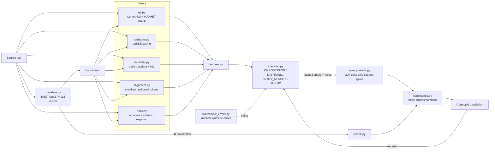

# Detection and Correction of Meaning Loss in Machine Translation

> Status: **All 8 phases built and tested.** Not done: the LLM-based baselines (c)/(d) (no API key), COMET (gated models), and the human annotation itself (the kit is ready, nobody has annotated yet). (setup + MT smoke test; synthetic error generator; detection signals; detection classifier with held-out test evaluation). CometKiwi/xCOMET signals are written but have never run on a real model (§7), so all Phase 4 numbers are **without QE features**. The span-guided vs no-spans LLM comparison of Phase 5 has **not been run yet** (needs `ANTHROPIC_API_KEY`, see §9). Sections marked _TBD_ are filled in as phases land.

## 1. Problem statement

Neural MT output is usually fluent, which hides the cases where it is **wrong**: content dropped, meaning flipped,
numbers or names altered, or text invented. Sentence-level quality scores say *that* something is off but not *what* or *where*.

This project builds a pipeline that (1) translates with a neural MT model, (2) **detects** meaning loss at sentence
level and, where possible, span level, classified into four error types, and (3) **corrects** only the flagged spans,
then re-checks the result.

| Type | Meaning |
|---|---|
| `OMISSION` | source content missing from the translation |
| `MISTRANSLATION` | meaning changed (negation flip, wrong sense, role swap) |
| `ENTITY_NUMBER` | names, dates, numbers or units wrong or missing |
| `HALLUCINATION` | content added that is not in the source |

Language pairs: **English→Hindi** (primary, IndicTrans2) and **English→German** (second pair, NLLB). Adding a pair is a config change (`configs/default.yaml → pairs`).

## 2. Architecture



_(Implemented so far: `translate.py`, config/cache/utils, data download, `synth/*`, `detect/{base,similarity,roundtrip,alignment,rules,qe,run}`. `features.py`, `classifier.py` and everything after are TBD.)_

## 3. Setup

```bash
cd mt-meaning-loss
/Library/Frameworks/Python.framework/Versions/3.12/bin/python3 -m venv .venv   # any Python >= 3.10
.venv/bin/pip install -r requirements.txt && .venv/bin/pip install -e . --no-deps
export HF_TOKEN=hf_...            # or: huggingface-cli login   (needed for gated models, see §4)
export ANTHROPIC_API_KEY=...      # only needed from Phase 5 (correction)
```

Hardware profiles (`--profile`): `mac_dev` (M1 8 GB laptop: dev, tests, smoke test; heavy models skipped) and
`colab_t4` (fp16, larger batches, XCOMET-XL and a 4-bit 7B LLM allowed). Heavy phases (3–6) are meant to run on the Colab T4.

## 4. Model and dataset verification (checked against the HF API on 2026-11-09)

| Role | Requested | Status | Notes |
|---|---|---|---|
| MT (Indic) | `ai4bharat/indictrans2-en-indic-dist-200M` | exists, **gated (auto-approve)** | needs `HF_TOKEN` + accepted terms; `trust_remote_code`, so the revision is **pinned** in the config |
| MT (other) | `facebook/nllb-200-distilled-600M` | exists, open (CC-BY-NC-4.0) | ships `pytorch_model.bin` only, hence `torch>=2.6` |
| QE sentence | `Unbabel/wmt22-cometkiwi-da` | exists, **gated** | needs token + accepted license; skipped with a warning otherwise |
| QE spans | `Unbabel/XCOMET-XL` | exists, **gated** | 3.5B params: Colab T4 only (fp16) |
| QE spans (lite) | `Unbabel/XCOMET-lite` | **does not exist** | the only "XCOMET-lite" repos are community uploads (`myyycroft/…`, `PingFiona/…`; the former is an unofficial distillation covering en/de/es/ru/zh only, so **not suitable for Hindi**). Default is XCOMET-XL; a fallback slot exists in the config. |
| Similarity | `sentence-transformers/LaBSE` | exists, open | |
| NLI | `MoritzLaurer/mDeBERTa-v3-base-xnli-multilingual-nli-2mil7` | exists, open | |
| NER (de) | `Davlan/xlm-roberta-base-ner-hrl` | exists, open | de/en/es/fr/it/nl/pt/ar/lv/zh. **Correction:** an earlier version of this table wrongly said it covers Hindi; it does not. |
| NER (hi) | `ai4bharat/IndicNER` | exists, **gated (auto-approve)** | covers Hindi + 10 other Indic languages; needs `HF_TOKEN`. Open Hindi NER models exist on the Hub but are unvetted community uploads with very low usage, so they are not used. |
| LLM (local) | `Qwen/Qwen2.5-7B-Instruct` (Colab) / `Qwen2.5-1.5B-Instruct` (CPU) | exist, open | API backend (Anthropic) is the default |

| Dataset | Status | Notes |
|---|---|---|
| FLORES-200 (Meta tarball, 25.6 MB) | reachable, **no token needed**, downloaded | **default** (`data.flores_source: flores200`). dev 997 / devtest 1012 sentences, line-aligned across `eng_Latn`, `hin_Deva`, `deu_Latn` |
| FLORES+ (`openlanguagedata/flores_plus`) | exists, **gated** | optional (`data.flores_source: flores_plus`, needs `HF_TOKEN` + accepted terms). Slightly revised successor of FLORES-200; the default is FLORES-200 so results are reproducible without a token |
| HalOmi (`facebookresearch/stopes`, `demo/halomi`) | reachable, 19.9 MB zip at `dl.fbaipublicfiles.com/nllb/halomi_release_v2.zip` | **No Hindi.** Covers German↔English only (plus ar/ru/es/zh/kas/mni/yor). CC-BY-NC 4.0. Used for the en-de pair. |
| WMT MQM with spans | reachable for en-de (WMT20 newstest, 43 MB TSV from `google/wmt-mqm-human-evaluation`) | **No MQM for English→Hindi.** Hindi evaluation therefore relies on synthetic data, so span-level F1 on real human annotations is available for en-de only. |

## 5. How to run

### Phase 1 — setup and smoke test

```bash
.venv/bin/python -m pytest -q                                   # unit tests
.venv/bin/mml smoke-test --pair en-hi                           # 20 sentences, end to end
.venv/bin/mml smoke-test --pair en-de                           # second pair
.venv/bin/mml translate "The meeting is at 5 pm." --n-best 3
.venv/bin/mml download-data --pair en-de --dry-run              # check data reachability, download nothing
scripts/download_data.sh en-hi                                  # real download (FLORES+ needs HF_TOKEN)
```

Every run writes `results/runs/<timestamp>_<name>/` with `config.yaml` (resolved config), `env.json` (package versions, seed,
token *presence* only) and `metrics.jsonl`. MT outputs are cached in `data/cache/mt.sqlite` keyed by model revision, languages,
decoding settings and text.

**Design decisions**
- *Graceful fallback, never silent:* if IndicTrans2 cannot load (gated + no token, build problem), `Translator.from_config`
  logs a warning, switches to NLLB, and records `fallback_used=true` in the run metrics. `--strict` disables the fallback.
- *Smoke checks are real checks:* each output must be non-empty, mostly in the target script (≥ 50% of letters), and for Latin-script targets differ from the source.
- *Pinned revisions* for both MT models for reproducibility (and because IndicTrans2 executes repository code via `trust_remote_code`).

### Phase 2 — synthetic error generator

```bash
.venv/bin/mml download-data --pair en-hi --what flores          # FLORES-200 (no token needed)
.venv/bin/mml synth --pair en-hi                                 # -> data/synthetic/en-hi/{train,val,test}.jsonl + manifest.json
.venv/bin/mml synth --pair en-de --balance                       # downsample all types to the rarest one
.venv/bin/mml synth --pair en-hi --ner                           # also use the NER model (needs HF_TOKEN for IndicNER)
.venv/bin/python -m pytest tests/test_synth_*.py -q
```

See [§6 Synthetic data](#6-synthetic-data-phase-2) for what is generated and how spans are guaranteed correct.

### Phase 3 — detection signals

```bash
.venv/bin/mml signals --pair en-hi --split val --limit 60                       # all signals; prints mean features per gold label
.venv/bin/mml signals --pair en-de --signals rules,labse,align,roundtrip        # choose signals
.venv/bin/python -m pytest -q                                                   # fast tests (stand-in models)
.venv/bin/python -m pytest -m slow -q                                           # real LaBSE / simalign / NLI / NLLB (downloads ~3 GB)
```
Colab T4 (CometKiwi, xCOMET-XL, large runs): open `notebooks/colab_signals.ipynb`; it installs `requirements-colab.txt`, reads `HF_TOKEN` from Colab secrets, and runs `mml signals --profile colab_t4`.

### Phase 4 — detection classifier

```bash
# one-time on the laptop: int8 CTranslate2 copy of NLLB for low-memory back-translation (23 s, 0.6 GB)
.venv/bin/mml convert-ct2
# signals -> feature tables (cached; resumable). `test` is only featurised here, never trained on.
.venv/bin/mml features --pair en-hi --splits train,val,test
.venv/bin/mml features --pair en-de --splits train,val,test
# select + ablate with grouped CV on train+val (no test data); writes results/detector/<pair>/report.md
.venv/bin/mml train-detector --pair en-hi
# final held-out evaluation: run ONCE per pair, after all choices are frozen
.venv/bin/mml train-detector --pair en-hi --evaluate-test
```
Models are saved to `models/<pair>/detector_{logreg,gbm}.joblib`.

### Phase 5 — correction

```bash
cp .env.example .env            # then put ANTHROPIC_API_KEY=... (and HF_TOKEN=...) in it; .env is git-ignored
.venv/bin/mml correct-compare --pair en-hi --show-prompts 4          # print the exact LLM prompts, no API call
.venv/bin/mml correct-compare --pair en-hi --strategies raw,constrained   # no API key needed
.venv/bin/mml correct-compare --pair en-hi --n 80                    # all strategies (calls the LLM: ~165 calls)
.venv/bin/mml rerank-eval --pair en-de --n 60 --n-best 4             # n-best re-ranking experiment (no API key)
```
Outputs go to `results/correction/<pair>/`. Both commands use **validation data only**; the test split is reserved for Phase 6.

### Phase 6 — evaluation

```bash
.venv/bin/mml evaluate --pair en-hi --real-n 300     # frozen detector + correction on the held-out TEST split and on real NLLB output
.venv/bin/mml evaluate --pair en-de --real-n 300
.venv/bin/mml report                                  # tables (CSV + markdown) and 4 plots in results/evaluation/
```
LLM strategies appear as `not run` in every table unless `ANTHROPIC_API_KEY` is configured.

### Phases 7–8

## 6. Synthetic data (Phase 2)

Correct FLORES references are corrupted with **one labelled error**; every corrupted example is paired with its
untouched ("clean") twin, so the number of clean and corrupted examples is exactly equal.

| Label | Mechanisms (`subtype`) |
|---|---|
| `OMISSION` | delete a comma clause (`omit_clause`), a trailing clause after a conjunction (`omit_conj_clause`) or a 2–4 word phrase (`omit_phrase`). Deleted text never contains a number, entity, date, unit or negation, so labels are unambiguous. |
| `MISTRANSLATION` | negation flip: remove/replace a negation word (`negation_remove`, `negation_swap` e.g. *keine→eine*) or insert one (`negation_insert`); entity-pair `role_swap` |
| `ENTITY_NUMBER` | `number_change` (one digit or magnitude, format-preserving: `4,5`, `9:30`, years only in the last two digits), `number_deleted`, `date_change` (month/weekday), `unit_change` (km↔m, Millionen↔Milliarden, …), `entity_replace` (same-type entity), `entity_deleted` |
| `HALLUCINATION` | an unrelated, negation-free, number-free sentence prepended or appended (`hallucination_prepend/append`) |

**Span guarantee.** Injectors only produce `Edit(start, end, new)` objects; one function (`apply_edits`) computes all offsets.
Each `errors[i]` stores `tgt_start/tgt_end/tgt_text` (the changed text in `hyp`; zero-width for deletions), `original_text`
and the full edit region. `invert_spans(hyp, errors) == ref` is asserted on **every** injection, and a test runs this over
all 997 FLORES dev sentences per language and error type, plus type-specific semantic checks (e.g. omissions never delete
digits or entities; negation count changes by exactly ±1).

**Splits (no leakage).** FLORES `devtest` → `test` (held out); FLORES `dev` → `train`/`val` (85/15 by hash of the sentence id).
Clean/corrupted twins always share a split, entity-replacement pools are built per split, and
`load_split(..., "test")` raises unless `for_final_eval=True`. `manifest.json` stores a hash of the test ids.

**Row format** (`*.jsonl`): `id, pair, split, origin_split, src, ref, hyp, label, subtype, errors[]`
with `errors[] = {type, subtype, tgt_start, tgt_end, tgt_text, original_text, edit_start, edit_end, group, src_start, src_end}`.
`src_start/src_end` (the aligned *source* span, needed for source-side omission evidence) are filled by the aligner in Phase 3.

**Generated sizes** (default settings, gazetteer entity finder; pairs of clean + corrupted):

| Pair | train | val | test | train types (OMISSION / MISTRANS. / ENTITY_NUMBER / HALLUC.) |
|---|---|---|---|---|
| en-hi | 1686 | 308 | 2024 | 224 / 224 / 171 / 224 |
| en-de | 1660 | 334 | 2024 | 223 / 222 / 162 / 223 |

**Known limitations of the synthetic data**
- *Entity coverage is small.* Built-in gazetteers (~70 Hindi / ~60 German names) find entities in a minority of sentences, so
  `entity_replace` is ≈ 25–35 train examples per pair and **`role_swap` is practically absent** (0–1 examples). Run with `--ner`
  (IndicNER for Hindi, Davlan XLM-R for German) to widen coverage; a true subject/object swap would need a dependency parser (future work).
- *Phrase omissions can be ungrammatical* (e.g. a dangling postposition) whereas real MT omissions are usually fluent; a detector could
  learn this surface cue. Clause omissions are fluent; phrase omissions are weighted lower where clauses exist.
- *German `negation_insert` is a heuristic* (after the first finite auxiliary, else before a final participle); Hindi inserts before the auxiliary run.
  Output is understandable but not always idiomatic.
- *Number words* ("zwei", "दो") are not altered; only digits.
- Hallucinations are *appended/prepended sentences*, the easy case; HalOmi-style mid-sentence hallucinations are only available for en-de via real data.
- Only ~850 clean/corrupted training pairs per language come from FLORES dev; more parallel data can be added through `ParallelItem`s.

## 7. Detection signals (Phase 3)

Every signal implements `compute(pairs) -> [SignalResult(features, spans)]` (`detect/base.py`). Results are cached in
`data/cache/signals.sqlite` keyed by signal, model/config signature and text pair (back-translations also in `mt.sqlite`),
computed in checkpointed chunks (an interrupted run resumes), and a signal that cannot run raises `SignalUnavailable` and is
**skipped with a logged reason, never replaced by placeholder numbers**. A full re-run over cached pairs took 1.6 s instead of 204 s.

| Signal (`--signals`) | Module | Features | Flagged spans | Status |
|---|---|---|---|---|
| `rules` | `rules.py` | number / date / negation-parity / entity / unit consistency (`num_*`, `date_*`, `neg_*`, `ent_*`, `lex_*`) | missing source numbers & entities, extra target numbers, negation cues | tested on real FLORES-based data |
| `labse` | `similarity.py` | `labse_cos` | – | real model tested |
| `align` | `alignment.py` (simalign, mBERT, itermax) | unaligned source/target ratios and longest unaligned runs | unaligned runs ≥ 2 tokens (source = omission evidence, target = hallucination evidence) | real model tested |
| `roundtrip` | `roundtrip.py` | NLLB back-translation, bidirectional mDeBERTa NLI (`nli_fwd/bwd_ent/con`), `bt_chrf` | – | real models tested |
| `cometkiwi` | `qe.py` | `kiwi_score` | – | **not run on a real model** (see below) |
| `xcomet` | `qe.py` | `xcomet_score`, error counts by severity, `xcomet_err_frac` | xCOMET error spans with severity | **not run on a real model** (see below) |

**COMET-family signals are untested against the real models.** They need `unbabel-comet` (kept out of the Mac environment because it pins
`numpy<2`), an HF token with both gated licenses accepted, and for xCOMET-XL a GPU. Their parsing logic, gating and caching are covered by
unit tests with an injected predictor, but the first real run happens on Colab (notebook provided); until then Phase 4 treats them as unavailable.

**Sanity check on 60 validation examples per pair** (means per gold label; indicative only, n≈6–20 per class):

| Feature | OK | OMISSION | HALLUC. | MISTRANS. | ENTITY_NUM | reading |
|---|---|---|---|---|---|---|
| en-hi `align_src_max_run` | 1.8 | **5.3** | 1.5 | 2.0 | 1.1 | omitted source words stay unaligned |
| en-hi `align_tgt_max_run` | 2.9 | 3.0 | **8.1** | 3.3 | 1.7 | added sentence stays unaligned |
| en-hi `nli_bwd_ent` | 0.76 | **0.35** | 0.57 | 0.10 | 0.14 | omission: back-translation no longer entails the source |
| en-hi `nli_fwd_con` | 0.10 | 0.29 | 0.14 | **0.86** | 0.68 | negation flips are contradictions |
| en-hi `neg_parity_mismatch` | 0.07 | 0.29 | 0.13 | **1.00** | 0.00 | rule |
| en-hi `num_missing` | 0.00 | 0.00 | 0.00 | 0.00 | **0.86** | rule |
| en-hi `labse_cos` | 0.875 | 0.811 | 0.828 | 0.829 | 0.873 | weak: LaBSE barely reacts to small edits |

Rule fire rates on the full synthetic *train* set (false-positive rate = rate on clean twins): numbers 100 % on number errors
(1–3 % FP), dates 100 % (1 % FP), units 100 % (1 % FP Hindi, 8 % German), negation parity 95–98 % on inserted negations (3 % FP).

**Limitations of the signals (honest notes)**
- `lex_*` features (entity and unit lexicons) use closed lists that overlap with the synthetic-error generator's gazetteer, so on synthetic data
  they look better than they will on real MT errors. Phase 4 reports every result **with and without `lex_*`**.
- Generic entity check: Hindi only checks acronyms/IDs (transliterated names cannot be string-matched); the German check still fires on ≈ 21 % of
  clean sentences (translated place names outside the exonym list). It is a weak feature.
- NLI is very sensitive to number/entity edits (`nli_fwd_con` is high for ENTITY_NUMBER too), so it separates "something changed" from "what changed" poorly;
  the classifier needs the rule/alignment features to tell the classes apart.
- Alignment runs also fire on legitimately unaligned function words (articles, postpositions).
- Back-translation quality bounds the round-trip signal; the target→source model is NLLB-600M for both pairs.

## 8. Detection classifier (Phase 4)

**Model.** One binary classifier per error type plus an "any error" model, so several errors can co-occur in real
translations; single-label metrics use the type with the highest `probability / threshold` among those above their
threshold, else `OK`. Logistic regression (standardised, class-balanced) and histogram gradient boosting are compared.
Features: 41 columns in six groups (`rules`, `lex`, `labse`, `align`, `roundtrip`, `surface`); **no QE group** because
CometKiwi/xCOMET did not run (§7).

**Protocol (no test leakage).** All choices (hyper-parameters, per-type thresholds, which model) use 5-fold cross-validation over
train+val where both versions of a source sentence form one group (a unit test shows a sentence-identifying feature cannot leak labels
across folds). The final model is refit on train+val and the held-out `devtest` split is scored **once per pair** (`--evaluate-test`).
Confidence intervals resample whole source sentences.

**Results** (5-class macro-F1 over OK + 4 types; per-type F1 on the test split):

| Pair | CV macro-F1 (selected) | **Test macro-F1** (95% CI) | Test any-error F1 | OMISSION | MISTRANSL. | ENTITY_NUM. | HALLUC. | LaBSE-threshold baseline (any-error F1) |
|---|---|---|---|---|---|---|---|---|
| en-hi | 0.856 (logreg) | **0.833** (0.815–0.851) | 0.859 | 0.674 | 0.891 | 0.871 | 0.873 | 0.697 |
| en-de | 0.889 (gbm) | **0.897** (0.882–0.913) | 0.913 | 0.770 | 0.941 | 0.897 | 0.963 | 0.706 |

Test MCC (multiclass): en-hi 0.774, en-de 0.860. Full per-class precision/recall/MCC tables, confusion matrices and the
model-selection trace are in `results/detector/<pair>/report.md` and `results.json`.

**Ablation** (grouped-CV macro-F1, best model; one group removed at a time):

| Removed group | en-hi | en-de | what it carries |
|---|---|---|---|
| none (all 41) | 0.856 | 0.889 | |
| `rules` | 0.701 | 0.787 | MISTRANSLATION (negation) and ENTITY_NUMBER: en-hi 0.91→0.69 and 0.89→0.41 |
| `lex` (closed lists) | 0.842 | 0.873 | ENTITY_NUMBER only (en-hi 0.89→0.81) |
| `roundtrip` | 0.838 | 0.864 | OMISSION and MISTRANSLATION |
| `align` | 0.853 | 0.871 | HALLUCINATION (en-de 0.945→0.889) |
| `labse` | 0.854 | 0.883 | almost nothing |
| `surface` | 0.854 | 0.892 | nothing (removing it is within noise) |

**Span-level F1** (character level, flagged signal spans gated by the predicted type, test split). Target side = exact injected spans
(gold); source side for deletions = **silver** gold from aligning source<->reference (11 of 355 deletion examples unmappable on train+val):

| Type (side) | en-hi P / R / F1 | en-de P / R / F1 |
|---|---|---|
| MISTRANSLATION (tgt) | 0.80 / 0.95 / 0.87 | 0.94 / 0.87 / 0.91 |
| ENTITY_NUMBER (tgt) | 0.83 / 0.93 / 0.88 | 0.78 / 0.93 / 0.85 |
| HALLUCINATION (tgt) | 0.51 / 0.77 / 0.61 | 0.85 / 0.86 / 0.85 |
| OMISSION (src, silver) | 0.46 / 0.42 / 0.44 | 0.71 / 0.48 / 0.57 |

**How to read these numbers (limitations).**
- **They measure synthetic errors, so they are an upper bound for real MT.** The rule features (negation parity, number/date/unit
  consistency) check exactly what the generator changes. Real translation errors are subtler, fluent and mixed.
  The check against real annotations (HalOmi for en-de; none exists for Hindi) is still to be done.
- **OMISSION is the weakest class** (F1 0.67 hi / 0.77 de, recall 0.6–0.74): a deleted phrase leaves little evidence for alignment or NLI.
  Hindi hallucination span precision is low (0.51): unaligned runs also appear on legitimate function words.
- **No QE features.** The "QE with a fixed threshold" baseline from the project brief is therefore replaced by a LaBSE threshold until the
  COMET models are run on Colab; the headline gap (0.70 -> 0.86-0.91) must not be quoted as a gain over QE.
- `lex_*` features share a closed list with the generator; removing them costs 0.014-0.016 macro-F1 (reported above), so they are not what drives the result, but they inflate entity numbers somewhat.
- Test macro-F1 sits within ~0.02 of the CV estimate in both pairs (lower for en-hi, higher for en-de), consistent with sampling noise.

**Running on the 8 GB laptop.** Signals run one at a time and each model is freed before the next loads (`detect/run.py`).
Back-translation uses an int8 CTranslate2 copy of NLLB on the laptop profile (0.45 s/sentence; chrF agreement with the fp32 model 0.94
on 60 sentences; round-trip chrF vs source 0.607 vs 0.617), and the HF fp32/fp16 model on Colab (`profiles.*.bt_backend`).
Cache keys include the backend, so the two never mix. The whole feature build for both pairs takes about two hours on the laptop.

## 9. Correction (Phase 5)

**Components** (`src/mml/correct/`, `llm.py`, `detect/predict.py`):

| Component | What it does |
|---|---|
| `Detector` (`detect/predict.py`) | text pair -> signals -> predicted error types, probabilities and flagged spans |
| `span_postedit.py` | **span-guided** LLM post-editing: the prompt holds the source, the translation and the detector's findings (type + the exact flagged source/translation text) and instructs the model to change nothing else. Unflagged sentences never reach the LLM. Also the **no-spans baseline**: same model and safeguards, but it sees only source + translation |
| `constrained.py` | rule-based **forcing** of numbers, dates, units and known names (German decimal comma, month/weekday names, unit and name lexicons; inserts a missing number in front of its unit). Order-aware number matching; every fix is re-checked by the consistency rules and reverted if it does not reduce the flags |
| `rerank.py` | choose among N MT candidates by detector P(error), with an optional margin so the MT model's first choice is kept unless the detector is clearly more confident |
| `llm.py` | backends `anthropic` (default, `claude-opus-5-5`, thinking on, `effort: medium`, server-side refusal fallbacks on), any OpenAI-compatible server, and a local HF model; one on-disk cache keyed by backend + model + exact prompt |

**Safeguards shared by both LLM modes:** the answer must be inside `<translation>` tags; an edit that rewrites more than 60% of the
sentence is rejected and the original kept; refusals, API errors and truncation return the original translation (a failure never loses the text).

**Reproducibility.** `claude-opus-5-5` does not accept `temperature`, so identical prompts are replayed from `data/cache/llm.sqlite` instead of re-sampled;
token usage and call counts are logged for cost tracking. **Credentials:** only `ANTHROPIC_API_KEY` is read (from the environment or the git-ignored `.env`),
requests go to the explicit `llm.anthropic.base_url`; ambient `ANTHROPIC_AUTH_TOKEN` / `ANTHROPIC_BASE_URL` values from other tools are deliberately ignored (tested).

**What has been measured so far** (validation data, 120 examples per pair = 60 corrupted + their 60 clean twins; the detector was trained on train+val, so detection numbers here are optimistic):

| Strategy | Pair | exact restoration of all errors | ENTITY_NUMBER restored exactly | chrF vs reference (before -> after) | clean sentences changed |
|---|---|---|---|---|---|
| raw | en-hi / en-de | 0 | 0 | 0.900 / 0.903 | 0 |
| constrained (rules only) | en-hi | 0.20 | 0.80 (12/15) | 0.900 -> 0.909 | 0.00 |
| constrained (rules only) | en-de | 0.18 | 0.73 (11/15) | 0.903 -> 0.909 | 0.00 |
| LLM, no spans (baseline c) | both | **not run** | | | |
| LLM, span-guided | both | **not run** | | | |
| constrained + span-guided LLM (`full`) | both | **not run** | | | |

The rule-based fixer only addresses ENTITY_NUMBER errors (a quarter of the corrupted examples), so ~0.2 is its ceiling. A separate property test over the full synthetic train set
requires it to restore > 70% of the rule-detectable entity/number errors while changing < 3% of clean sentences. While building it, the sweep found and fixed a real bug:
greedy number matching swapped the positions of repeated numbers ("3 ... 3" vs source "1 ... 3"); matching is now order-preserving (regression tests added).
**Caveat:** the lexicons behind date/unit/name fixing overlap with the synthetic-error generator, so on synthetic data this component looks better than it will on real MT output.

**N-best re-ranking: a negative result.** For 60 validation sources, 4-best lists from NLLB (int8) were re-ranked by detector P(any error):

| Pair | chrF top-1 | re-ranked (plain argmin) | oracle best-of-4 | margin 0.1 (switches top-1 in) |
|---|---|---|---|---|
| en-de | 0.596 | 0.603 (changes top-1 for 63%) | 0.627 | 0.602 (12%) |
| en-hi | 0.592 | 0.584 (70%) | 0.615 | 0.591 (8%) |

Plain re-ranking changes most choices without a reliable gain (+0.007 for en-de, -0.007 for en-hi; both within noise for n = 60). The detector was trained to spot injected
corruptions, not to rank fluent near-duplicates, so its probabilities carry little information among candidates. The conservative `margin` rule avoids harm but also does
almost nothing; the margin sweep is exploratory and was not used to tune for gain. A ranker trained on real candidate pairs (or COMET-QE) is future work.

**Prompt quality finding.** Unaligned-word runs are the noisiest evidence (function words): one Hindi example listed six "hallucination" findings of which one was real. The prompt
therefore keeps only the two longest unaligned runs per side but all precise rule findings (numbers, dates, units, names, negation), and tells the model the detector may be wrong.

**Deferred (by decision, 2026-11-16):** the three LLM strategies (span-guided vs no-spans vs full) were **not run**: no API key was configured and the LLM runs were skipped. The code, prompts, safeguards and 181 tests are in place, so this is one command once `ANTHROPIC_API_KEY` is in `.env` (or a local/Colab model is chosen via `llm.backend: hf_local`). Until then, **no claim is made in this report about span-guided LLM post-editing versus the no-spans baseline.** The full
evaluation (COMET/chrF before vs after on the **test** split, % of flagged errors fixed, per type) is Phase 6.


## 10. Results (end-to-end, Phase 6)

Everything below uses the **held-out test split** (FLORES `devtest`, 1,012 clean + 1,012 corrupted sentences per pair) with settings frozen on train/val, plus 300 real NLLB translations of `devtest` sources.
Tables: `results/evaluation/*.csv|md`; plots: `results/evaluation/fig1-4*.png`; raw numbers: `results/evaluation/<pair>/results.json`.

**What was and was not run.** Baseline (a) raw MT and (b) a fixed-threshold flagger were run. **(c) LLM post-editing without spans and (d) the full pipeline with span-guided LLM editing were NOT run** (no API key; skipped by decision),
so there is **no measured comparison of span-guided vs no-span post-editing in this report**. **COMET / xCOMET were not computed** (gated models, no token, GPU needed): all quality numbers are chrF against the reference, and baseline (b)
uses a LaBSE-similarity threshold instead of a COMET-QE threshold. What *was* run for (d) is its LLM-free part, (d'): detector + rule-based fixer.

**Baselines on the test split** (n = 1,012 corrupted + 1,012 clean per pair):

| Pair | Method | flags errors | falsely flags clean | errors restored exactly | chrF gain on errors | clean sentences changed |
|---|---|---|---|---|---|---|
| en-hi | (a) raw MT | – | – | 0 | 0 | 0 |
| en-hi | (b) LaBSE-similarity threshold (flag only) | 0.842 | **0.573** | cannot correct | | |
| en-hi | (c) LLM, no spans | not run | | | | |
| en-hi | (d) full = detector + rules + span-guided LLM | not run | | | | |
| en-hi | (d') detector + rule-based fixer, no LLM | 0.861 | 0.143 | 0.141 | +0.0068 | 0.005 |
| en-de | (a) raw MT | – | – | 0 | 0 | 0 |
| en-de | (b) LaBSE-similarity threshold (flag only) | 0.894 | **0.637** | cannot correct | | |
| en-de | (c) LLM, no spans | not run | | | | |
| en-de | (d) full | not run | | | | |
| en-de | (d') detector + rule-based fixer, no LLM | 0.906 | 0.079 | 0.141 | +0.0054 | 0.008 |

The threshold baseline flags nearly as many errors as the detector but also flags 57-64% of *correct* sentences, which makes it unusable as a gate for editing; the detector's false-alarm rate is 14% (hi) / 8% (de).

**Per error type, (d')** (`results_table.md` has every column):

| Pair | Type | n | detector flags it | restored exactly | flags cleared on re-detection | chrF before -> after | made worse |
|---|---|---|---|---|---|---|---|
| en-hi | Entity / number | 221 | 0.91 | **0.647** | 0.673 | 0.946 -> 0.978 | 2.7% |
| en-hi | Omission, Mistranslation, Hallucination | 263 / 264 / 264 | 0.67 / 0.93 / 0.93 | 0 | ~0 | unchanged | <1% |
| en-de | Entity / number | 212 | 0.95 | **0.675** | 0.716 | 0.958 -> 0.985 | 2.8% |
| en-de | Omission, Mistranslation, Hallucination | 266 / 267 / 267 | 0.77 / 0.95 / 0.97 | 0 | ~0 | unchanged | <1% |

Without an LLM, only the rule-based fixer corrects anything, and it only addresses entity/number errors (a quarter of the errors), so 14% of all errors restored is its **ceiling, not a tuned result**; omissions, mistranslations and hallucinations are detected but left unfixed.
Detection quality (F1 per class, test split) is in §8 and `results/evaluation/fig1_detection_f1_per_class.png`.

**Real MT output** (300 FLORES `devtest` sentences, NLLB-600M int8; for en-hi this is NLLB because IndicTrans2 needs a token): the detector flags **9% (hi) / 15% (de)** of the translations, and the rule-based fixer **edited none of them**. chrF is unchanged (0.571 hi, 0.617 de).
Flagged translations have lower chrF to the reference than unflagged ones (hi 0.508 vs 0.578; de 0.507 vs 0.637), weak and purely descriptive evidence that the flags track real problems (it also reflects harder or more paraphrastic sentences). **There is no evidence yet that the pipeline improves real translations**; the strong synthetic numbers must not be read as real MT quality.

**A bug found by this evaluation (disclosure).** The first real-MT run edited 3 German sentences, two of them wrongly: version numbers and times such as "802.11n" and "12.00 Uhr" were rewritten with a decimal comma ("802,11n"), because the rules read the German "." as a thousands separator and flagged a number that was already correct.
The constrained fixer now never rewrites a number that is written exactly as in the source (regression tests added). This fix was motivated by test-derived output, so it is disclosed here rather than hidden: the pre-fix results are kept in `results/evaluation/<pair>/results_before_verbatim_number_fix.json`.
Effect: synthetic restoration unchanged (0.141 / 0.141), clean sentences changed 1.0% -> 0.8% (de; unchanged 0.5% for hi), real-MT edits 3 (2 harmful) -> 0. No other change was made after seeing test results.

**Plots** (light theme; palette validated with the data-viz validator: CVD dE 24.7, normal-vision dE 33.6; each chart has one y-axis and a legend, and was inspected after rendering, which caught and fixed label-placement bugs in figures 2 and 3):
1. `fig1_detection_f1_per_class.png`: F1 per class on the test split, both pairs.
2. `fig2_ablation_drop_one_group.png`: change in cross-validated macro-F1 when a feature group is removed.
3. `fig3_correction_per_type.png`: share of errors fully fixed and chrF change per error type (rule-based correction).
4. `fig4_false_alarms_and_overcorrection.png`: false alarms of the threshold baseline and the detector, and over-correction by the fixer, on clean sentences.

## 11. Human-evaluation kit (Phase 7)

Purpose: measure the detector on **real** MT errors with human judgements, which no earlier phase could do (all quality numbers so far
come from synthetic errors). The kit is built; **no human annotations have been collected yet, so this report contains no human-evaluation
results.**

**Design** (`src/mml/human_eval/`):
* **Items are real MT output** (NLLB translations of FLORES `devtest` sources), 100 per language pair: 45 detector-flagged + 45 unflagged + 10
  *attention checks* (synthetic items with known answers, to see that annotators read carefully). Sampling is **stratified** by the detector's flag
  because a plain random sample would contain too few flagged sentences (pool of 595 sentences: 52 flagged = 8.7% for en-hi, 82 = 13.8% for en-de).
* **Annotators are blind**: the form shows only source and translation, no detector output and no reference. Item order is shuffled differently per annotator; ids carry no information.
* **Labels**: "meaning preserved?" (yes/no) and, for errors, any of omission / mistranslation / entity-number / hallucination, plus optional problem words and notes. Guidelines with examples are included.
* **Formats**: a UTF-8-with-BOM CSV (opens correctly in spreadsheets with Devanagari) and a self-contained **offline HTML form** (no network; progress saved in the browser; *Download CSV* button).
* **Hidden key** (`key_DO_NOT_SHARE_WITH_ANNOTATORS.csv`) holds the detector verdicts, findings and references. Everything meant for annotators is in `results/human_eval/<pair>/for_annotators/`: **send only that folder.**

```bash
.venv/bin/mml human-eval-kit --pair en-hi --n 100 --checks 10 --pool-n 600    # or --reuse-pool; also for en-de
# annotators fill for_annotators/annotator_A.html (or .csv) and send back annotations_A.csv / annotations_B.csv
.venv/bin/mml human-eval-iaa --pair en-hi --a annotations_A.csv --b annotations_B.csv
```
Annotators need to read English and the target language (Hindi or German), so choose the pair that matches them.

**Agreement and analysis** (`human_eval/iaa.py`, output `results/human_eval/<pair>/iaa_report.md|json`, `disagreements.csv`):
* input validation with explicit warnings (unlabeled items, unreadable values, error types ticked on "preserved" items, duplicates, unknown ids);
* **Cohen's kappa** with bootstrap 95% CIs, observed agreement and a Landis-Koch reading for "meaning preserved" and each error type (rare labels give unstable kappa, so the report shows agreement and CIs next to it);
* **attention-check accuracy** per annotator;
* **detector vs human consensus**: precision / recall / F1 for "any error" and each type, **re-weighted for the stratified sample** (weights = stratum size in the pool / items sampled), with bootstrap CIs. A unit test checks the estimator against a case with a known exact answer (population precision 0.80, recall 0.47, while the naive unweighted recall would read about 0.89).

**What was verified.** 13 unit tests, including kappa against scikit-learn and known 2x2 values, a full run with **simulated** annotators (in tests only; never stored as results), and blindness checks (no detector text, reference or stratum label in anything annotators receive).
The generated HTML form was also **driven in a browser**: it renders Devanagari correctly, records answers (progress counter, green "done" state), reveals the error types only for "No", and its CSV export contains the right values per item, blanks for unanswered items, 101 rows and the UTF-8 BOM bytes.

**Limitations.** Two annotators give a noisy kappa on 90 items, rare error types will have very few positives, and the attention checks are synthetic (some corruptions are subtle). The detector-vs-human numbers use the consensus items only.

## 12. Demo (Phase 8)

```bash
.venv/bin/mml demo --pair en-hi        # http://127.0.0.1:7860 ; en-de is selectable in the app; --strategy auto|constrained|full|none
```
Type English text (up to 8 sentences). The app machine-translates it, then shows: the **source and translation with problem spans highlighted by error type** (omission, mistranslation, entity/number, hallucination), a table of the detector's confidence and flags, a **findings** table explaining every highlighted span in words, the **corrected translation with edited words highlighted**, and an edit table (before / after).
An optional box lets you **paste your own translation** (one source sentence) to check and correct it instead of machine-translating, which is the easiest way to see the corrector work (e.g. paste a German translation that says "45" for "4.5").

How it works: `resident.py` keeps all models loaded between requests (int8 NLLB shared by both translation directions); the first request loads them (about 35 s), later requests take a few seconds. About 4-5 GB are resident per language pair, so **only one pair is kept in memory**: switching pairs releases the previous one first.
The app runs on **localhost only**, with Gradio analytics and its version check disabled (verified: no outbound request in the server log). `gradio>=5,<6` is pinned because Gradio 6 requires `huggingface-hub` 1.x, which would break the pinned `transformers` 4.x.

**Verified in a browser** (Gradio 5.50): empty input shows a clear error **without loading any model** (a bug found and fixed during testing: the handler used to load ~3 GB of models before validating); a correct translation is judged clean; a wrong number is highlighted on both sides, flagged at 99-100%, and corrected ("45" -> "4.5" in Hindi, "45" -> "4,5" in German); a real machine-translation omission is highlighted with the honest message that **no automatic fix was applied** because the rule-based strategy cannot repair omissions; switching pair works and frees the old models first (swap dropped from 5.6 to 4.2 GB). Other bugs fixed from the browser session: a misleading "OMISSION" headline for a below-threshold probability (now a plain table), a stray colour scale, mid-word line breaks in highlighted English, and narrow table columns.
14+ unit tests cover the pure helpers (sentence splitting, span highlighting with overlap priority and Unicode, diffs, offsets across sentences, status messages, request validation) and the app wiring with a fake pipeline.

**Caveats shown in the app and true of the system.** The detector was trained on **synthetic** errors (false alarms ≈ 8-14% on correct sentences); without an LLM the corrector only fixes numbers, dates, units and known names; omissions/mistranslations/hallucinations are highlighted but not repaired.
The highlighted evidence is imperfect: for "The tiger's roar is not like the full-voiced roar of a lion..." the detector flagged "of a lion" as missing although the Hindi contains it (the real omissions are elsewhere), consistent with the silver-span F1 of only 0.44 for omissions (§8). The demo splits input into sentences, which also avoids NLLB's tendency to drop content from multi-sentence inputs. For en-hi the translation is NLLB, because IndicTrans2 needs an HF token.

## 13. Limitations
- No human-annotated meaning-loss data for English→Hindi (no MQM, no HalOmi); Hindi detector quality is measured on synthetic errors plus a small human-eval sample.
- `XCOMET-lite` does not exist officially; span-level QE needs XCOMET-XL (GPU).
- NLLB-600M and COMET models are licensed CC-BY-NC: research use only.
- Synthetic-data limitations are listed in §6.

## 14. Future work
- Dependency-parse-based subject/object swap; mid-sentence hallucinations; number-word errors.
- Run the LLM baselines (c)/(d) and COMET evaluation (needs `ANTHROPIC_API_KEY` / `HF_TOKEN` + Colab).
- A candidate ranker trained on real MT n-best lists (re-ranking by the current detector does not help, §9).

## 15. License

The code is released under the [MIT License](LICENSE). The datasets and pretrained models it downloads (FLORES-200, NLLB, LaBSE, NLI models, etc.) keep their own licenses and terms of use.
